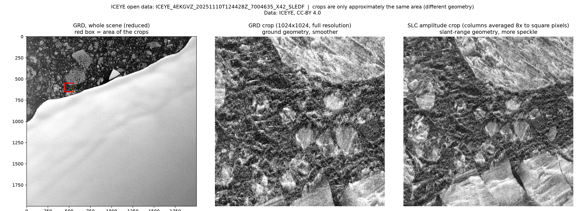
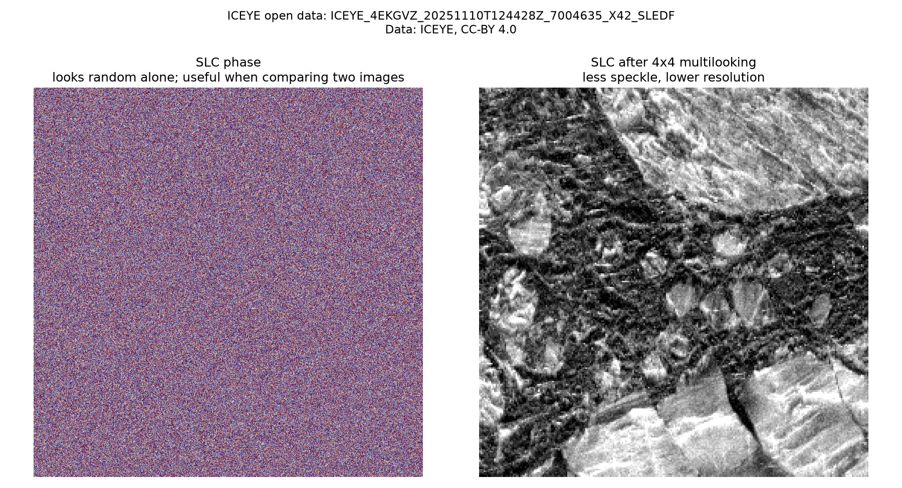

# ICEYE GRD vs SLC: a hands-on comparison

A small Python demo that loads one ICEYE radar (SAR) scene straight from ICEYE's public open-data bucket, compares the two main product types, **GRD** and **SLC**, and explains which customer needs which.

Data: ICEYE, CC-BY 4.0.

## The scene

| | |
| --- | --- |
| Scene ID | `ICEYE_4EKGVZ_20251110T124428Z_7004635_X42_SLEDF` |
| Date | 10 November 2025 |
| Imaging mode | Dwell Fine (spotlight family) |
| Location | Weddell Sea, off the Antarctic Peninsula (about 71.0° S, 60.6° W) |
| GRD | 20,000 × 20,000 pixels at 1 m, `uint16` amplitude |
| SLC | 114,630 × 13,650 pixels, 2 × `float32` bands (amplitude and phase) |

The scene shows sea ice: dark open water with drifting ice floes, next to a bright, smooth area of solid ice. Water looks dark in radar because a calm surface reflects the signal away from the satellite; rough ice scatters it back.

## Result 1: GRD vs SLC



- **Left:** the whole GRD scene (reduced). The red box marks the crop area.
- **Middle:** full-resolution GRD crop. Projected onto the ground with square 1 m pixels, so it lines up like a map.
- **Right:** SLC amplitude crop of roughly the same area. It is in the satellite's own (slant-range) geometry, so the floes appear slightly shifted, and it keeps more speckle and fine texture.

## Result 2: what SLC adds — phase



- **Left:** the SLC phase. In a single image it looks random, because each pixel combines reflections from many small objects. It becomes useful when two SLC images of the same place are compared: the phase difference reveals ground movement down to millimetres (InSAR).
- **Right:** the SLC amplitude after averaging neighbouring pixels (multilooking). Less speckle, lower resolution.

## Which customer needs which product?

| | GRD | SLC |
| --- | --- | --- |
| Contains | Amplitude only, projected onto the ground | Amplitude and phase, in satellite geometry |
| Ready to use? | Yes: drops straight into a GIS | No: needs SAR processing knowledge |
| Typical customers | Insurers (flood and damage mapping), GIS analysts, maritime monitoring | Deformation monitoring (InSAR), researchers, teams with their own processing chains |

Most customers only need GRD. Recommending SLC to someone who does not need it costs them time and effort.

## Problems I solved

**1. The SLC phase looked wrong.**
The first phase image was a single flat colour instead of noise. My hypothesis was that the two SLC bands were not real and imaginary parts, as I had assumed, but amplitude and phase. The band names in the file were empty, so I checked the value ranges: band 1 was always positive (up to about 2,600) and band 2 ran exactly from −π to +π. That confirmed amplitude + phase. I fixed the reading code to build the complex value as `amplitude × e^(i·phase)`.

**2. The SLC crop looked stretched into streaks.**
SLC pixels are not square: the spacing along the flight direction is much finer than across it, which is why the file is 114,630 pixels wide but only 13,650 tall. A square crop therefore covered a short distance one way and a long distance the other. I read a crop 8× wider and averaged groups of 8 columns, which made the pixels roughly square. After that, the SLC showed the same floes as the GRD.

**3. The first crop showed only speckle.**
It sat in the uniform ice area. I moved it to the edge between water and ice, where there is structure to compare.

## How to run it

```bash
pip install -r requirements.txt
python ICEYE_slc_grd_demo.py        # lists available scenes
python ICEYE_slc_grd_demo.py 0      # runs the demo on scene 0
```

Settings at the top of the script: `CROP` (crop size), `CROP_X` / `CROP_Y` (crop position as fractions of the image), `SLC_SQUASH` (columns averaged in the SLC).

## Limitations and next steps

- The GRD and SLC crops cover only approximately the same area, because the two products use different geometry. An exact match would need the geolocation metadata.
- `SLC_SQUASH = 8` was chosen by eye. The exact value can be calculated from the pixel spacings in the SLC metadata file.
- Next step: compare two acquisitions of the same location (the catalog has near-daily images of some sites) to show change detection.

## Data and licence

Data: ICEYE Open Data, CC-BY 4.0 — https://registry.opendata.aws/iceye-opendata/
